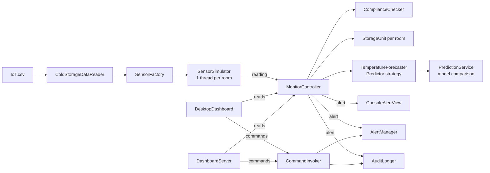

# Smart Cold Storage Monitor

Smart Cold Storage Monitor is a Java application for cold storage facility managers, quality assurance officers and maintenance engineers. Food, vaccines and medicines are damaged when storage temperatures leave their safe range, and manual checks can miss short spikes and slow, prolonged violations. The system simulates live IoT temperature sensors (one thread per storage room, replaying recorded data, optionally with injected temperature spikes), classifies every reading against the safe range of 2.0–4.0 °C as COMPLIANT, WARNING or NON-COMPLIANT, raises visual and audio alarms that operators can acknowledge or silence, predicts each room's upcoming temperature to warn about spoilage risk, evaluates whether the third-party maintenance contractor meets its temperature standard, and records every violation and operator action in a tamper-evident, SHA-256 hash-linked audit log aligned with NIST SP 800-53. Results are shown in a desktop dashboard (Swing), a web dashboard, and the console.

## Team

| Member | GitHub Username | Role |
|---|---|---|
| Aakriti Kaul | [@aak-kaul](https://github.com/aak-kaul) | Core monitoring pipeline, alert management and commands, audit logging, run modes, integration tests, README |
| Yazi Zhang | [@Lizik01](https://github.com/Lizik01) | ML analytics: statistics, temperature prediction models, model evaluation, forecast output |
| Anqi Zhou | [@AnqiAngelZhou](https://github.com/AnqiAngelZhou) | Views: desktop dashboard (Swing), web dashboard, console view |
| Togzhan Usseiin | [@Usseiint](https://github.com/Usseiint) | Sensor data ingestion, real-time multi-threaded simulation |

## Repository Structure

The packages follow the Model–View–Controller design from our Phase 1 document: the **model** holds domain state, the **controller** processes readings and notifies observers, and the **views** only display data and turn button clicks into commands. Ingestion, simulation, analytics, alert management and audit logging each live in their own package.

```
smart-cold-storage-monitor/
  pom.xml                     Maven build (Java 17, JUnit 5); no other dependencies
  src/main/java/edu/northeastern/coldstorage/
    Main.java                 Entry point: parses options and runs batch / simulate / web / gui mode
    app/                      AppOptions (command-line options), MonitoringSystem (wires all parts together)
    model/                    Domain objects: SensorReading, StorageUnit, Alert, ComplianceStatus,
                              MonitoringReport, Forecast
    data/                     ColdStorageDataReader: CSV ingestion, skips and counts invalid rows
    sensor/                   Sensor, CsvReplaySensor, SpikeSensor (Decorator), SensorType,
                              SensorFactory (Factory pattern), SensorSimulator (ScheduledExecutorService,
                              one task per sensor)
    ml/                       ComplianceChecker (thresholds, contractor 5% rule), StatisticsCalculator,
                              TemperaturePredictor / Predictor + LinearRegressionPredictor +
                              MovingAveragePredictor (Strategy), PredictionService, TemperatureForecaster,
                              PredictorEvaluator, PredictionModel
    controller/               MonitorController (thread-safe: store, classify, alert, forecast, report),
                              AlertListener (Observer interface)
    alerts/                   AlertManager: active alerts, alarm state, silence/re-arm rules
    command/                  OperatorCommand + Acknowledge / AcknowledgeAll / SilenceAlarm /
                              ChangePredictor commands, CommandInvoker (audits every action)
    view/                     ConsoleAlertView (console summary)
    view/desktop/             DesktopDashboard (Swing window), table models, status colour renderer
    view/web/                 DashboardServer (REST API on the JDK HTTP server), DashboardJson, JsonWriter
    logging/                  AuditLogger (Singleton, SHA-256 hash chain), AuditEntry
  src/main/resources/
    IoT.csv                   Hourly dataset: 4,977 readings from 3 rooms
    cold_storage_high_frequency.csv   Per-minute dataset: 10,075 readings from 1 room
    web/dashboard.html        Web dashboard page (self-contained HTML, CSS and JavaScript)
  src/test/java/edu/northeastern/coldstorage/
    <one folder per package>  Unit tests for every component
    integration/              End-to-end tests of the key workflows
```

### How the parts work together



## Setup and Run

**Prerequisites:** Java 17 or newer, Maven 3.8+ (bundled with IntelliJ IDEA), and Git. No accounts, API keys, environment variables or internet connection are needed; both datasets are included in `src/main/resources/`.

```bash
# Clone
git clone https://github.com/aak-kaul/smart-cold-storage-monitor.git
cd smart-cold-storage-monitor

# Install dependencies and build
mvn compile

# Run the application (pick a mode)
mvn compile exec:java                                   # batch: process IoT.csv and print a summary
mvn compile exec:java -Dexec.args="--mode=simulate"     # live sensor threads, alerts printed as they happen
mvn compile exec:java -Dexec.args="--mode=simulate --sensor=spike"   # adds a +3.0 C spike to every 10th reading
mvn compile exec:java -Dexec.args="--mode=web"          # live simulation + web dashboard: open http://localhost:8080
mvn compile exec:java -Dexec.args="--mode=gui"          # live simulation + desktop dashboard window
mvn compile exec:java -Dexec.args="--help"              # list every option

# Run tests (unit + integration)
mvn test
```

**In IntelliJ IDEA:** File → Open → select the project folder and wait for Maven to load. Open `Main.java` and click ▶ next to `main` (batch mode). For the other modes, open **Run → Edit Configurations…**, select `Main`, and type e.g. `--mode=gui` in **Program arguments**. To run all tests, right-click `src/test/java` → **Run 'All Tests'**.

**Options:**

| Option | Values | Default |
|---|---|---|
| `--mode` | `batch`, `simulate`, `web`, `gui` | `batch` |
| `--data` | a CSV file path, or a bundled dataset name (`IoT.csv`, `cold_storage_high_frequency.csv`) | `IoT.csv` |
| `--interval` | milliseconds between readings of each sensor | `100` |
| `--sensor` | `csv-replay`, or `spike` (adds +3.0 C to every 10th reading, to trigger alerts in demos) | `csv-replay` |
| `--predictor` | `moving-average`, `linear` | `moving-average` |
| `--port` | web dashboard port | `8080` |
| `--alerts` | how many alerts to print on the console | `15` |

Example: `--mode=web --interval=20 --predictor=linear` replays the data faster with the linear-regression model. If port 8080 is busy, add `--port=8081`. The audit log is written to `logs/audit.log` (git-ignored).

**Expected batch output (abridged):**
```
Loaded 4977 readings from IoT.csv (0 invalid rows skipped)
Safe range: 2.0 to 4.0 C, warning margin +/- 1.0 C, prediction model: Moving average
...
  COMPLIANT      (GREEN)   2404   48.3%  ##############................
  WARNING        (YELLOW)  2207   44.3%  #############.................
  NON-COMPLIANT  (RED)      366    7.4%  ##............................
FORECAST (Moving average, 3 readings ahead)
  Cold_Storage_A       4.52 C  WARNING        <- spoilage risk predicted
  Cold_Storage_B       1.43 C  WARNING        <- spoilage risk predicted
  Cold_Storage_C       3.89 C  COMPLIANT
Contractor (TMC) compliance: FAIL (7.4% non-compliant, limit 5.0%)
Next-reading forecast by model (last 24 readings per room):
  Cold_Storage_A      Linear regression:   4.55 C (WARNING)        Moving average:   4.52 C (WARNING)
  ...
Prediction accuracy on this data (mean absolute error, 3 readings ahead):
  Linear regression  1.30 C
  Moving average     0.98 C
Audit log: 2577 entries, integrity check: PASSED
```

**Dataset:** [IoT Based Cold Storage Monitoring System](https://www.kaggle.com/datasets/sohilsingh11/iot-based-cold-storage-mointoring-system) (Kaggle). `IoT.csv`: 4,977 hourly readings from `Cold_Storage_A`, `B` and `C` (Jan–Jul 2024; mean 4.07 °C, range −3.94 to 18.97 °C). `cold_storage_high_frequency.csv`: 10,075 per-minute readings from one unit.

## Features and Functional Requirements

| Functional Requirement (from Phase 1) | Status | What is implemented |
|---|---|---|
| FR1: Sensor data ingestion (read CSV, simulate real-time readings at adjustable intervals) | **Complete** | `ColdStorageDataReader` loads either dataset (columns found by name; bad rows skipped and counted). `SensorFactory` creates one sensor per room (`CsvReplaySensor`, or `SpikeSensor` with `--sensor=spike`); `SensorSimulator` runs them concurrently on a `ScheduledExecutorService`. The interval is set with `--interval`. |
| FR2: Machine learning analytics (average, variance, predict future temperatures with regression) | **Complete** | Overall and per-room mean, variance and standard deviation (running Welford updates). Two prediction models behind the `TemperaturePredictor` / `Predictor` strategy: linear regression (least squares) and moving average. `TemperatureForecaster` forecasts every room 3 readings ahead and flags predicted spoilage risk; `PredictionService` keeps a bounded per-room history, swaps models at runtime and forecasts any `StorageUnit`, which the summary uses to compare both models. `PredictorEvaluator` measures accuracy on real data. |
| FR3: Compliance monitoring (2.0–4.0 °C; COMPLIANT / WARNING / NON-COMPLIANT) | **Complete** | Every reading is classified; WARNING is up to 1.0 °C outside the safe range (the 5.0 °C breach limit). The contractor fails if more than 5% of readings are non-compliant. |
| FR4: Web dashboard (interactive charts, variance trends, active alerts, compliance history) | **Complete** | `DashboardServer` serves a REST API and a dashboard page: live room cards (current, mean, std dev, min/max, green/yellow/red counts), a temperature-trend chart with safe band and forecast point, the contractor result, active alerts with acknowledge buttons, alarm banner, model switch. Refreshes every second. |
| FR5: Alert management (visual and audio alarms; acknowledge or silence) | **Complete** | `AlertManager` tracks active alerts and the alarm. Desktop: flashing alarm banner and system beep; web: alarm banner and optional browser beep. Operators can acknowledge one alert, acknowledge all, or silence the alarm (re-armed by the next critical alert). |
| FR6: Security and audit logging (tamper-evident logs of violations, system changes, operator actions) | **Complete** | `AuditLogger` records violations, system events (start, data loaded, simulation, finish) and every operator action (via `CommandInvoker`) in a SHA-256 hash chain; `verifyIntegrity()` detects edited or deleted entries. Each entry is flushed to disk immediately. |

**Primary use case, working end to end ("Detect unsafe storage conditions"):**
1. Sensors (one thread per room) send readings to `MonitorController` at the configured interval.
2. The controller stores each reading in its room's `StorageUnit` (current temperature, running statistics, recent history).
3. `ComplianceChecker` classifies the reading; `TemperatureForecaster` predicts the room's next temperatures.
4. If the reading is unsafe, an `Alert` is sent to every observer: the console prints it, `AlertManager` adds it to the active list and sounds the alarm, `AuditLogger` records it.
5. The desktop and web dashboards show current status, statistics, forecasts and alerts; the operator acknowledges alerts or silences the alarm, and each action is audited.
6. At the end, a summary report, both models' accuracy and the audit-log integrity result are printed.

**Non-functional requirements:**

| Requirement | Target | Result |
|---|---|---|
| Throughput | ≥ 100 readings per second | Batch processes all 4,977 readings in well under a second (checked by `BatchWorkflowIntegrationTest`) |
| Concurrency safety | Multiple sensors update shared data safely | Synchronized controller and alert manager, copied snapshots for views; concurrency and live-vs-batch tests give identical results |
| Usability | Colour-coded status | Green / yellow / red in all three views, always with a text label |
| Security | Tamper-evident logs | SHA-256 hash chain with integrity check; tests prove edits and deletions are detected |

## Changes Since Phase 1 (and why)

| Change | Reason |
|---|---|
| **Thresholds made consistent:** COMPLIANT 2.0–4.0 °C; WARNING within 1.0 °C outside (1.0–2.0 °C or 4.0–5.0 °C); NON-COMPLIANT beyond. Defined once in `ComplianceChecker` and read by every view. | Phase 1 feedback: the thresholds differed between sections (2.0–4.0 °C range vs. 5.0 °C breach line in the mockup). One source of truth prevents the views from disagreeing. |
| **Timing targets made consistent:** sensors default to one reading per 100 ms (adjustable); throughput target ≥ 100 readings/s; dashboards refresh every 1 s (web) and 0.5 s (desktop). | Phase 1 feedback: timing targets differed between sections. A "dashboard update under 100 ms" target was replaced with a fixed refresh rate, because faster refreshes are not visible to people and only waste CPU. |
| **Desktop UI brought forward** and built with **Swing** (not JavaFX). | Phase 1 feedback suggested a basic UI early. Swing is built into the JDK, while JavaFX has been a separate download since Java 11, so Swing keeps setup to "install Java". |
| **Web dashboard uses the JDK's built-in HTTP server** and a self-contained page instead of Spring Boot, Tailwind CSS and Chart.js. | The API has six endpoints, so a full framework was unnecessary. The built-in server needs no dependencies, and the page works offline (e.g. in a classroom without internet). The chart is drawn on an HTML canvas. |
| **Prediction models implemented ourselves** (linear regression, moving average) instead of Weka / Smile / Commons Math. | Both models are short and easy to explain and test. Avoiding a large library keeps the build simple. |
| **Moving average is the default model.** | Measured on IoT.csv, 3 readings ahead: moving average 0.98 °C error vs. linear regression 1.30 °C. Linear regression stays available (`--predictor=linear` or the model drop-down) because it reacts faster to steady trends. |
| **Testing with JUnit 5 only** (no AssertJ or Mockito). | The observer interface is a single method, so tests use small lambdas as fakes. Fewer libraries are easier for all members to set up. |
| **Two prediction designs joined into one strategy.** `Predictor` (used by the live forecaster and dashboards) extends `TemperaturePredictor` (used by `PredictionService`), so both work with the same two model classes. | Two team members built prediction code in parallel. Joining the interfaces kept both members' work, instead of deleting one, and every model works everywhere. |
| **Sensors replay recorded data, plus a `SpikeSensor` that injects spikes** (instead of synthetic random sensors). | No hardware is available; the spike sensor makes alerts happen on purpose in demos and tests. |
| **Maven** chosen (Phase 1 listed Gradle or Maven). | Simple, widely documented, and bundled with IntelliJ. |
| **Dataset statistics updated.** | Phase 1 estimated a mean of 2.96 °C; the full dataset's mean is 4.07 °C (range −3.94 to 18.97 °C). |

### Out of scope

- Physical sensor hardware: sensors are simulated by replaying the dataset (optionally with injected spikes).
- Cloud deployment, user accounts and authentication: the dashboards run locally.
- Email/SMS notifications and a mobile app.
- Deep-learning prediction models.
- Formal NIST certification: we demonstrate alignment with selected SP 800-53 controls (AU-2, AU-3, AU-9) only.
- Multi-facility management.

## Design Patterns and Principles

| Pattern / principle | Where | Why |
|---|---|---|
| **Observer** | `AlertListener`; `MonitorController` notifies `ConsoleAlertView`, `AlertManager`, `AuditLogger` | The controller doesn't know who reacts to an alert; new reactions plug in without changing it. |
| **Singleton** | `AuditLogger` | Exactly one audit trail, so every event lands in the same hash chain. |
| **Strategy** | `TemperaturePredictor` / `Predictor` with `LinearRegressionPredictor` and `MovingAveragePredictor`, used by `TemperatureForecaster` and `PredictionService` | Models can be swapped at runtime (GUI drop-down, web, command line, `ChangePredictorCommand`) without changing the code that uses them. |
| **Command** | `OperatorCommand` implementations run by `CommandInvoker` | Desktop and web actions are handled the same way, and every action is automatically audited. |
| **Factory** | `SensorFactory.create(SensorType, id, readings)` returns a `CsvReplaySensor` or `SpikeSensor` | The simulator depends only on the `Sensor` interface; a new sensor type needs one class and one case in the factory. |
| **Decorator** | `SpikeSensor` wraps any `Sensor` | Adds temperature spikes to another sensor's readings without changing that sensor. |
| **MVC** | model/, controller/ + command/, view/ | Views only display and send commands, so the console, desktop and web views share the same logic. |
| **Single responsibility** | One job per class (e.g. reading CSV, classifying, forecasting, rendering JSON) | Each class is small and has its own unit tests. |
| **Program to interfaces** | `Sensor`, `Predictor`, `AlertListener`, `OperatorCommand` | Components depend on abstractions, which makes them easy to replace and test. |
| **Thread safety by design** | `synchronized` controller and alert manager; views receive copies (`StorageUnit.copy()`); `volatile` predictor | Sensor threads write while GUI and web threads read, without data races. |
| **Composition root** | `MonitoringSystem` | All wiring happens in one class, so `Main` stays short and integration tests run the exact same system. |

## Testing

- **Framework:** JUnit 5, run by Maven Surefire (`mvn test`).
- **181 tests in 33 test classes, all passing.**
- **Unit tests** cover every main component: compliance rules and boundaries, statistics, CSV reading (bad rows, BOM, padding, both datasets), storage units (running statistics, 48-reading history, copies), alerts and the alert manager (acknowledge, silence, re-arm), commands and auditing, both prediction models, the forecaster and the prediction service (history, strategy switching, forecasts from a storage unit), model evaluation, forecasts, sensors and the factory, the simulator, JSON output, the web server's endpoints and error handling, desktop table models, console output, and command-line options.
- **Integration tests** run the whole system end to end:
  - `BatchWorkflowIntegrationTest` (3): the primary use case on the full IoT.csv (exact counts 2,404 / 2,207 / 366, contractor FAIL, alerts reaching all three observers, audit integrity, printed summary), the at-least-100-readings-per-second throughput target, and the high-frequency dataset.
  - `SimulationWorkflowIntegrationTest` (3): a live multi-threaded simulation gives exactly the same counts, statistics, alerts and forecasts as batch processing (proves thread safety); readings arrive gradually; spike sensors raise extra alerts.
  - `OperatorWorkflowIntegrationTest` (3): a warming room raises alerts and the alarm; the operator silences and acknowledges over HTTP; the actions are audited and the hash chain stays intact; a new critical reading re-arms the alarm; switching the model from the dashboard changes forecasts.
  - `SensorSimulatorTest` (3) and `PredictionIntegrationTest` (2): sensors through the full pipeline concurrently; both models backtested on IoT.csv.
  - `DashboardServerTest` also starts the real web server and calls every endpoint over HTTP.
- **Coverage:** not measured with a tool yet (planned for the QA phase).

```bash
mvn test                                         # all tests
mvn test -Dtest='*IntegrationTest'               # integration tests only
mvn test -Dtest=OperatorWorkflowIntegrationTest  # one test class
```

## Known Issues

- `ConsoleAlertViewTest.nonCompliantAlertIsPrintedInRed` failed once on a teammate's Windows machine in Phase 2 (Java 25); we will recheck it on Windows in QA.
- Humidity is read and stored but not analyzed.
- A room needs a few readings before it has a forecast (moving average 1, linear regression 2).
- `--mode=gui` needs a screen; without one the program suggests `--mode=web`. In web mode the program keeps serving after the simulation ends, until Ctrl+C.

## Next Steps

- Let operators change the safe range and interval from the dashboards (currently set in code and on the command line).
- Persist readings and alert history to a database so they survive a restart.
- Add more prediction models (e.g. exponential smoothing) and compare them with `PredictorEvaluator`.
- Add authentication to the web dashboard and serve it over HTTPS if it is ever deployed beyond a single machine.

## Team Contributions

| Member | Phase 2 | Phase 3 |
|---|---|---|
| Aakriti Kaul | Repository, Maven project and package structure; dataset integration; core use case (`SensorReading`, `StorageUnit`, `Alert`, `ComplianceStatus`, `MonitoringReport`, `ComplianceChecker`, `StatisticsCalculator`, `MonitorController`, `AlertListener`, `AuditLogger`, `AuditEntry`, `Main`); first 33 tests; README | Alert management and Command pattern: `AlertManager` (alarm, silence, re-arm), alert IDs, `OperatorCommand`, acknowledge / acknowledge-all / silence commands, `CommandInvoker` (every action audited as `OPERATOR_ACTION`); `StorageUnit` history and copies for thread-safe views; run modes: `AppOptions` (incl. `--sensor`), `MonitoringSystem` (composition root), batch / simulate / web / gui in `Main`, audit-log flushing; joined the two prediction designs so the whole project builds; tests: `AlertManagerTest`, `CommandInvokerTest`, `MonitorControllerConcurrencyTest`, `AlertTest`, `StorageUnitHistoryTest`, `AppOptionsTest`, integration tests (batch, simulation, operator workflows); Phase 3 README |
| Yazi Zhang | `getStandardDeviation()` in `StorageUnit`; `StorageUnitTest` | Temperature prediction (FR2): `TemperaturePredictor` (Strategy), `LinearRegressionPredictor`, `MovingAveragePredictor`, `PredictionService` (per-room bounded history, runtime model switching, predicted status, forecasts from a `StorageUnit`, backtesting), `PredictorEvaluator`, `Forecast`, `ChangePredictorCommand`; forecasts in the console output; tests: `PredictionServiceTest`, `PredictionIntegrationTest`, `PredictorEvaluatorTest`, `ForecastTest`, `ChangePredictorCommandTest`, predictor tests; README rows for FR2 and Strategy |
| Anqi Zhou | Redesigned console summary in `ConsoleAlertView`; `ConsoleAlertViewTest` | Desktop dashboard (`DesktopDashboard`, `RoomTableModel`, `AlertTableModel`, `StatusCellRenderer`); web dashboard (`DashboardServer` REST API, `DashboardJson`, `JsonWriter`, `dashboard.html` with live chart, alerts and alarm); committed the live-forecast integration for the team (`Predictor`, `PredictionModel`, `TemperatureForecaster`, forecasts in `MonitorController`, `MonitoringReport` and `ConsoleAlertView`); tests including real HTTP tests of every endpoint, `DesktopTableModelTest`, `TemperatureForecasterTest`, `MonitorControllerForecastTest`, `ConsoleAlertViewForecastTest`; README updates |
| Togzhan Usseiin | High-frequency dataset; reader tests (BOM, padded values, CRLF, high-frequency data) | Real-time simulation: `Sensor`, `CsvReplaySensor`, `SpikeSensor`, `SensorType`, `SensorFactory` (Factory pattern), multi-threaded `SensorSimulator` (`ScheduledExecutorService`, adjustable interval, stop/await); thread safety for `MonitorController` and `StorageUnit`; `SensorFactoryTest` and `SensorSimulatorTest` (integration and concurrency tests); README update to the Phase 3 structure |
