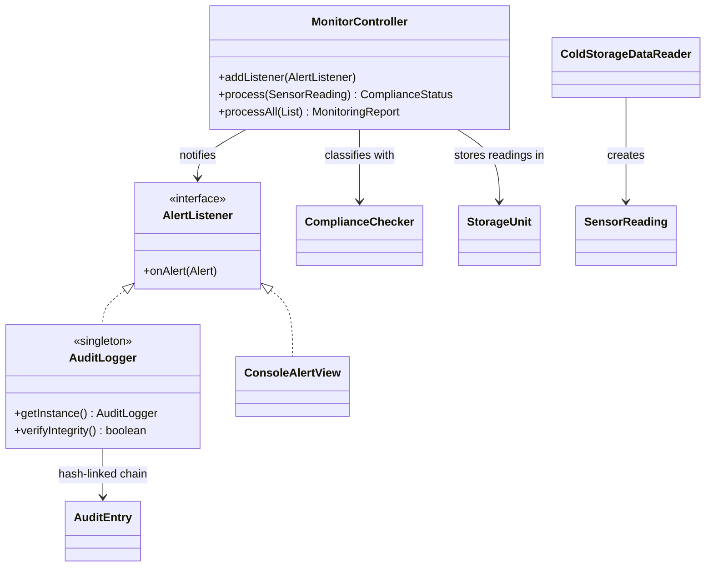

# Smart Cold Storage Monitor

Smart Cold Storage Monitor is a Java application for cold storage facility managers, quality assurance officers and maintenance engineers. Food, vaccines and medicines are damaged when storage temperatures leave their safe range, and manual checks can miss short spikes and slow, prolonged violations. The system reads cold storage sensor data, classifies every reading against the safe range of 2.0 to 4.0 °C as COMPLIANT, WARNING or NON-COMPLIANT, alerts users about unsafe conditions, tracks running statistics for each storage room, evaluates whether the third-party maintenance contractor meets its temperature standard, and records every violation in a tamper-evident, SHA-256 hash-linked audit log aligned with NIST SP 800-53.

## Team

| Member | GitHub Username | Role |
|---|---|---|
| Aakriti Kaul | [@aak-kaul](https://github.com/aak-kaul) | Project setup, core monitoring pipeline, audit logging |
| Yazi Zhang | [@Lizik01](https://github.com/Lizik01) | ML analytics (statistics, temperature prediction) |
| Anqi Zhou | [@AnqiAngelZhou](https://github.com/AnqiAngelZhou) | Views (desktop GUI and web dashboard) |
| Togzhan Usseiin | [@Usseiint](https://github.com/Usseiint) | Sensor data ingestion and real-time simulation |

## Repository Structure

The layout follows the Model–View–Controller design from our Phase 1 document. The model holds domain state, the controller coordinates each reading and notifies observers, and the view only displays results. Data ingestion, analytics and audit logging are kept in their own packages.

```
smart-cold-storage-monitor/
  pom.xml                                Maven build (Java 17, JUnit 5)
  src/main/java/edu/northeastern/coldstorage/
    Main.java                            Entry point: runs the core use case end to end
    model/                               Domain objects: SensorReading, StorageUnit, Alert,
                                         ComplianceStatus, MonitoringReport
    data/                                ColdStorageDataReader: CSV ingestion, skips invalid rows
    ml/                                  ComplianceChecker (threshold rules, contractor 5% rule),
                                         StatisticsCalculator (mean, variance, std deviation)
    controller/                          MonitorController (store, check, alert, report),
                                         AlertListener (Observer interface)
    view/                                ConsoleAlertView: colour-coded alerts and summary
    logging/                             AuditLogger (Singleton, SHA-256 hash chain), AuditEntry
  src/main/resources/
    IoT.csv                              Kaggle dataset: 4,977 readings, 3 rooms
  src/test/java/edu/northeastern/coldstorage/
    controller/ data/ logging/ ml/       JUnit 5 test suites, one per component
```

### Design patterns used so far

| Pattern | Where | Why |
|---|---|---|
| Observer | `AlertListener` implemented by `ConsoleAlertView` and `AuditLogger`; notified by `MonitorController` | New views (desktop GUI, web dashboard) can subscribe to alerts without changing the controller |
| Singleton | `AuditLogger` | Exactly one audit trail, so every event lands in the same hash chain |



## Setup and Run

**Prerequisites:** Java 17 or newer, Maven 3.8+ (bundled with IntelliJ IDEA), and Git. No accounts, API keys or environment variables are needed. The dataset is included in `src/main/resources/IoT.csv`.

```bash
# Clone
git clone https://github.com/aak-kaul/smart-cold-storage-monitor.git
cd smart-cold-storage-monitor

# Install dependencies and build
mvn compile

# Run the application
mvn compile exec:java

# Run tests
mvn test
```

**In IntelliJ IDEA:** File → Open → select the project folder and wait for Maven to load. Run `src/main/java/edu/northeastern/coldstorage/Main.java` with the ▶ button. To run the tests, right-click `src/test/java` and choose **Run 'All Tests'**.

To analyze another CSV in the same format: `mvn compile exec:java -Dexec.args="path/to/file.csv"`. The audit log is written to `logs/audit.log` (git-ignored).

**Expected output (abridged):**
```
Loaded 4977 readings from IoT.csv (0 invalid rows skipped)
Safe range: 2.0 to 4.0 C, warning margin +/- 1.0 C
ALERT [WARNING] Cold_Storage_C at 2024-01-02T00:00: 4.17 C -> YELLOW
...
  COMPLIANT      (GREEN ):  2404  (48.3%)
  WARNING        (YELLOW):  2207  (44.3%)
  NON-COMPLIANT  (RED   ):   366  (7.4%)
Mean temperature   : 4.07 C
Contractor (TMC) compliance: FAIL (7.4% non-compliant, limit 5.0%)
Audit log: 2576 entries written to logs/audit.log, integrity check: PASSED
```

**Dataset:** [IoT Based Cold Storage Monitoring System](https://www.kaggle.com/datasets/sohilsingh11/iot-based-cold-storage-mointoring-system) (Kaggle), `IoT.csv`: 4,977 hourly readings from `Cold_Storage_A`, `B` and `C`, January–July 2024. The actual mean is 4.07 °C (range −3.94 to 18.97 °C), which updates the estimate in our Phase 1 proposal.

## Progress So Far

| Functional Requirement (from Phase 1) | Status | Notes |
|---|---|---|
| FR1: Sensor data ingestion | Partial | Historical CSV ingestion is complete, with columns looked up by name and invalid rows skipped and counted. Real-time simulation at adjustable intervals with multi-threading is not started. |
| FR2: Machine learning analytics | Partial | Mean and variance are computed overall and per room; each `StorageUnit` keeps running statistics. Regression-based temperature prediction is not started. |
| FR3: Compliance monitoring | Complete | Every reading is classified as COMPLIANT (2.0–4.0 °C), WARNING (within 1.0 °C outside, up to the 5.0 °C breach limit) or NON-COMPLIANT. The contractor fails if more than 5% of readings are non-compliant. |
| FR4: Web dashboard | Not started | A console dashboard stands in for now. Spring Boot and Chart.js are planned. |
| FR5: Alert management | Partial | Alerts are raised for every unsafe reading and pushed to all listeners (Observer). Visual and audio alarms and acknowledge/silence actions are not started; `Alert` already supports acknowledgement in the model. |
| FR6: Security and audit logging | Partial | Violations and system events go into a SHA-256 hash-linked log with integrity verification (NIST SP 800-53 AU-2, AU-3, AU-9). Logging of operator actions will follow once those actions exist. |

**Working end to end:** the core use case "Detect unsafe storage conditions."
1. `ColdStorageDataReader` loads 4,977 readings from `IoT.csv`.
2. For each reading, `MonitorController` stores it in its room's `StorageUnit`, updating the current temperature, status and running mean and variance.
3. `ComplianceChecker` classifies the reading as COMPLIANT, WARNING or NON-COMPLIANT.
4. If the reading is unsafe, an `Alert` is created and every registered `AlertListener` is notified.
5. `ConsoleAlertView` prints the alert with its colour (green, yellow or red), and `AuditLogger` records it as a hash-linked entry.
6. At the end, a `MonitoringReport` is printed with status counts, overall statistics, each room's current state and the contractor's PASS/FAIL result, and the audit log's integrity is verified.

## Testing So Far

- **Framework:** JUnit 5, run through Maven Surefire.
- **33 unit tests across 5 test classes, all passing:**
  - `ComplianceCheckerTest` (9): green, yellow and red rules, exact 2.0 and 4.0 boundaries, custom limits, invalid limits, the contractor 5% rule
  - `StatisticsCalculatorTest` (4): mean, variance and standard deviation against hand-calculated values; empty input
  - `ColdStorageDataReaderTest` (7): valid parsing, bad rows skipped, any column order, missing columns, empty input, loading the real dataset
  - `MonitorControllerTest` (7): alerts only for unsafe readings, multiple and removed listeners, per-room running statistics, report totals
  - `AuditLoggerTest` (6): singleton, hash linking, detection of edited and deleted entries, alert logging, file output

## Next Steps (Phase 3)

- Simulate live sensors with multi-threading (`ScheduledExecutorService`) at adjustable intervals, with a `SensorFactory` (Factory pattern) and thread-safe shared state.
- Add temperature prediction with linear regression behind a `Predictor` interface (Strategy pattern), so models can be swapped.
- Add operator actions to acknowledge and silence alerts (Command pattern), recorded in the audit log.
- Build the JavaFX or Swing desktop GUI (MVC) with colour-coded status and an audio alarm.
- Build the Spring Boot REST API and web dashboard (Tailwind CSS, Chart.js) with temperature trends, variance and compliance history.

## Team Contributions

| Member | Contributions This Phase |
|---|---|
| Aakriti Kaul | Created the GitHub repository, Maven project and package structure; integrated the Kaggle dataset; implemented the core use case: `SensorReading`, `StorageUnit`, `Alert`, `ComplianceStatus`, `MonitoringReport`, `ColdStorageDataReader`, `ComplianceChecker`, `StatisticsCalculator`, `MonitorController`, `AlertListener`, `ConsoleAlertView`, `AuditLogger`, `AuditEntry` and `Main`; wrote the 33 JUnit tests; wrote the README |
| Yazi Zhang | Wrote `StorageUnitTest`, which verifies the running mean and variance for each storage room and checks that readings from the wrong room are rejected; added a `getStandardDeviation()` method to `StorageUnit` with tests |
| Anqi Zhou | Wrote `ConsoleAlertViewTest`, which verifies that alerts are printed with their status colour and that the alert display limit and "... and N more alerts" message work correctly; improved the layout of the console monitoring summary, updated `ConsoleAlertView` |
| Togzhan Usseiin | Extended `ColdStorageDataReader` to support the `cold_storage_high_frequency.csv` dataset, with tests; added tests for CSV files that contain a byte-order mark or extra spaces around values |
